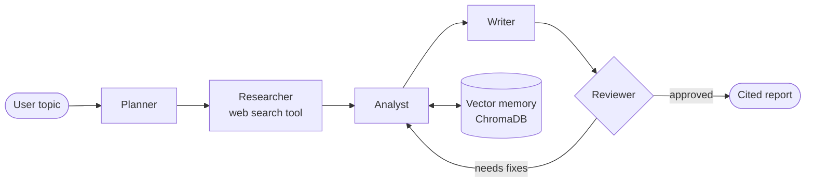

<!-- ============================== HEADER ============================== -->
<p align="center">
  
</p>

<p align="center">
  <a href="https://git.io/typing-svg">
    
  </a>
</p>

<p align="center">
  <a href="https://www.linkedin.com/in/abdellatif-mahamat-dougouye/"></a>
  <a href="mailto:abdelmahamt50@gmail.com"></a>
  
  
</p>

---

## 👨‍💻 About me

```python
class Abdellatif:
    role     = "Information Systems Engineering Student (PFE year)"
    school   = ["ENSA Khouribga", "1337 (42 Network)"]
    focus    = ["Machine Learning", "MLOps", "Agentic AI & LLM systems"]
    looking  = "5–6 month End-of-Studies Internship in AI / ML — starting January 2027"
    languages = {"French": "Fluent", "Arabic": "Fluent", "English": "B2"}

    def mindset(self):
        return "Go beyond the notebook: from model to deployed, monitored service."
```

- 🧠 Exploring **agentic AI**: multi-agent orchestration, tool use, RAG, self-critique loops
- 🚀 Passionate about **MLOps**: serving, experiment tracking, drift monitoring, CI/CD
- 📈 Experienced with **time-series ML** and rigorous, leakage-free evaluation

---

## 🚀 Featured projects

<table>
<tr>
<td width="50%" valign="top">

### 🤖 AgentHub
**Multi-agent system for automated tech watch & report generation**

An autonomous team of agents that researches a topic and writes a cited technical report.

- 🧩 **LangGraph** orchestration: Planner, Researcher, Analyst, Writer, Reviewer
- 🔁 **ReAct** loop + self-critique agent to reduce hallucinations
- 🛠️ Tool use / function calling (web search)
- 🧠 Persistent memory with **ChromaDB**
- 🔍 Agent tracing with **LangSmith**
- 🐳 Served with **FastAPI / Streamlit** and **Docker**


</td>
<td width="50%" valign="top">

### ⚙️ Predictive Maintenance
**RUL estimation on industrial sensor data (NASA C-MAPSS)**

End-to-end time-series ML pipeline built during my internship at 1337 Coding School.

- 📊 Feature engineering: rolling windows, trend/slope features
- 🏆 Compared **Linear Regression, XGBoost, LightGBM, LSTM**
- 🎯 Custom score penalizing *late* failure predictions
- 🚢 **FastAPI + Docker** deployment, **MLflow** tracking
- 📉 Drift detection (**PSI**, **KS test**) + **Streamlit** dashboard


</td>
</tr>
</table>

> 📌 *Add the links to your repositories here once they are public.*

### 🧭 AgentHub architecture



---

## 🛠️ Tech stack

<p align="center">
  
</p>

| 🧠 AI & ML | ⚙️ MLOps & Monitoring | ☁️ DevOps & Backend |
|---|---|---|
| Scikit-learn, XGBoost, LightGBM | MLflow, FastAPI, Model Serving | Docker, Kubernetes |
| PyTorch, LSTM, 1D-CNN | Data drift (PSI, KS test) | Microsoft Azure |
| LangGraph, CrewAI, RAG | Streamlit, Grafana | GitHub Actions, CI/CD |
| ChromaDB, LangSmith | Experiment tracking | Git, Linux, PostgreSQL, MySQL |

**Languages:** Python • SQL • Java • JavaScript • C

---

## 📊 GitHub stats

<p align="center">
  
  
</p>
<p align="center">
  
</p>

---

## 📫 Let's connect

I'm open to **AI / Machine Learning internship opportunities** and always happy to talk about MLOps, agentic systems or time-series ML.

<p align="center">
  📧 <b>abdelmahamt50@gmail.com</b> &nbsp;•&nbsp;
  💼 <a href="https://www.linkedin.com/in/abdellatif-mahamat-dougouye/">LinkedIn</a> &nbsp;•&nbsp;
  📍 Khouribga, Morocco
</p>

<p align="center">
  
</p>
